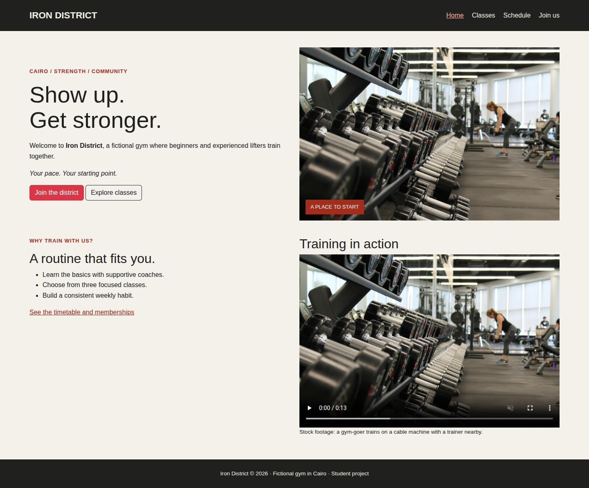
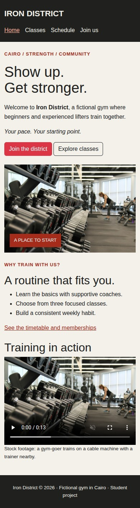
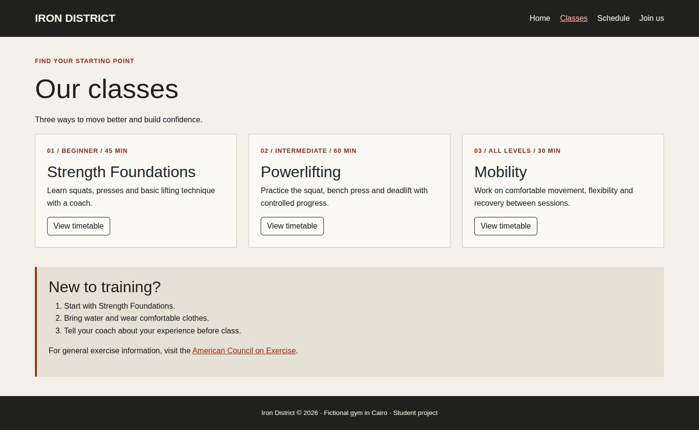
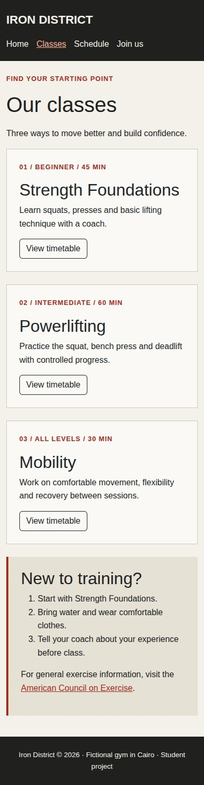
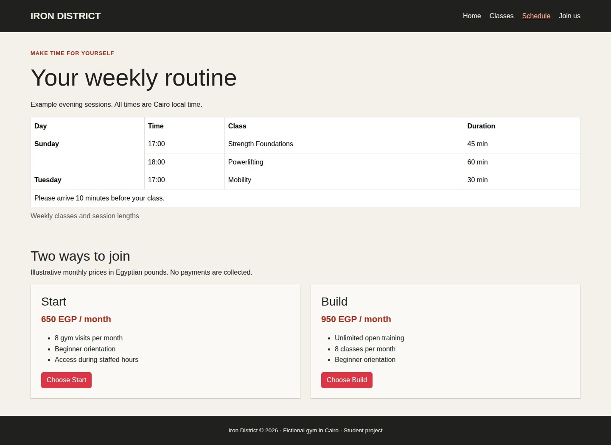
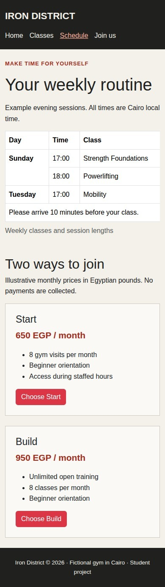
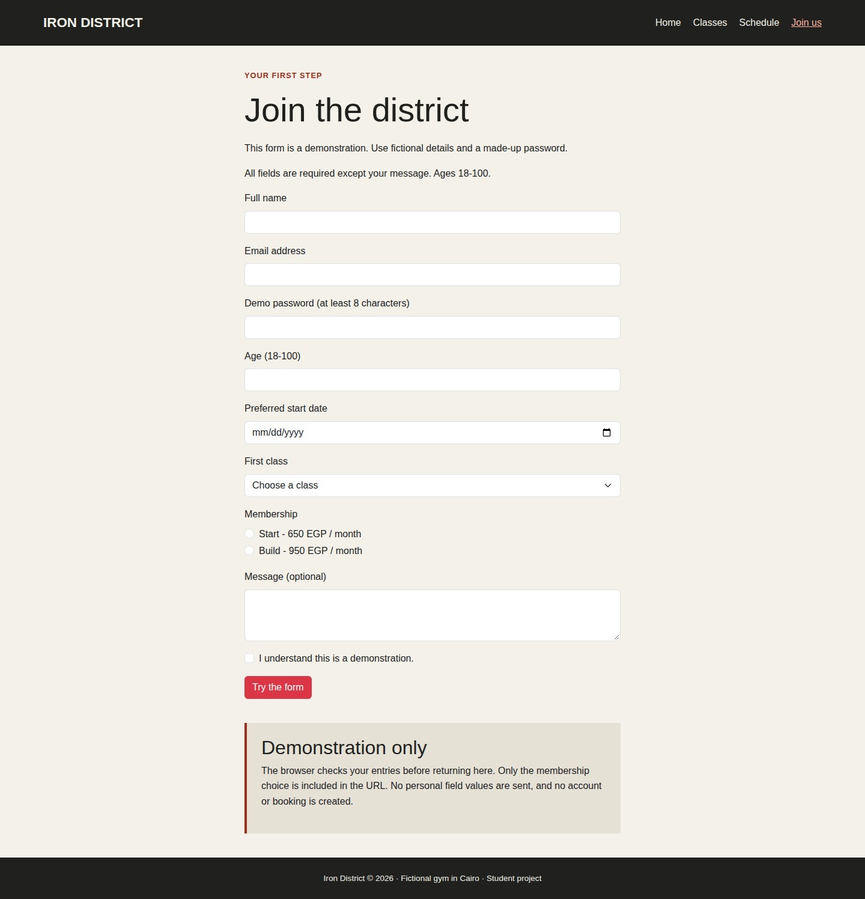
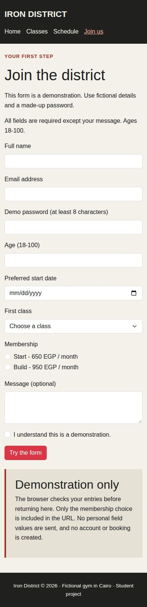

# Iron District - Project Report

**Name:** Mohamed Ahmed Hussein Talaat  
**Student ID:** 224120930

[Live website](https://mohamedtalaat23.github.io/iron-district-gym/) | [PDF report](report/report.pdf)

## Topic and purpose

Iron District is a fictional gym in Cairo. This static website introduces three classes, shows a weekly timetable, compares two membership plans, and demonstrates a join form. It uses HTML5, CSS3, and local Bootstrap 5.3.3 CSS. There is no JavaScript, backend, database, or payment service.

## Running the website

Open `index.html` in a browser. Bootstrap, the photograph, and the video are included locally, so the website works offline without installing anything. The four HTML pages share one custom stylesheet, `assets/style.css`.

## Site map

Every page has the same navigation linking Home, Classes, Schedule, and Join us. The brand links to Home. Additional links connect the pages as follows:

- Home (`index.html`) links to Classes, Schedule, and Join.
- Classes (`classes.html`) links to Schedule through each class card.
- Schedule (`schedule.html`) links to Join through both membership cards.
- Join (`join.html`) returns to its demonstration note after a valid form submission.

## Requirements checklist

| Assignment item | Where it is used |
| --- | --- |
| Page structure and semantics | Every page has doctype, head, title, charset, viewport and description metadata, plus header, nav, main, section and footer. Class and membership cards are articles; Classes and Join use aside. |
| Text and links | Headings and paragraphs appear throughout. Home uses strong and em. Navigation and buttons link between pages; Classes has an external exercise information link. |
| Images, lists and media | Home has an image with alt text, an unordered benefits list, and a local video with controls and fallback link. Classes has an ordered beginner checklist. |
| Tables and merged cells | Schedule uses caption, thead, tbody and scoped headers. Sunday's heading has rowspan="2"; the arrival note has colspan="4". |
| Forms and validation | Join has text, email, password, number, date, radio, checkbox, select, textarea and submit controls. Labels match IDs. Required, minlength, min and max provide native validation. |
| External CSS, selectors and pseudo-classes | assets/style.css contains element, class, grouped and descendant selectors. Links use :hover and :focus-visible; buttons also use :focus-visible. |
| Colors, backgrounds, fonts and box model | The custom stylesheet sets cream and dark backgrounds, red accents, font families, sizes, line height, margins, padding and borders. |
| Positioning and display | Home's photo uses position: relative and its label uses position: absolute. Video uses display: block; navigation uses flex and membership plans use grid. |
| Flexbox and Grid | Custom .site-nav arranges and wraps navigation links. Custom .membership-grid creates two equal membership columns using 1fr 1fr and a gap. |
| Responsive design | The max-width: 767px media query stacks plans, gives the brand a separate row, reduces heading size and adjusts spacing. Bootstrap columns stack on smaller screens; table-responsive contains horizontal table scrolling. |
| Bootstrap | Local Bootstrap supplies container, row, col-md-6, col-md-4, g-4, align-items-center, cards, buttons, image sizing, table styling and form components. Custom CSS supplies additional design and required layout examples. |

## Form demonstration

Join is a static demonstration. Use fictional details and a made-up password. The browser validates required fields, email syntax, a password of at least eight characters, and ages from 18 to 100. The message is optional.

Personal controls intentionally have IDs but no submission names: labels and validation work, but their values are not sent. The two membership radios share name="membership" and have values "start" and "build", so only one can be selected. A valid GET submission returns to `join.html?membership=start#form-note` or the Build equivalent. The note is always visible; it is not a registration receipt. No personal field values are sent, and no account or booking is created.

## Verification

HTML5 parsing found no parser errors or duplicate IDs, and local file references resolve. Browser checks covered phone, tablet and desktop widths, with no page-wide horizontal overflow. The timetable scrolls inside its own container. Checks also covered navigation, active-page links, required fields, invalid email, a typed short password, age limits, radio exclusivity, valid submission, and local video playback. These are local Chromium-family checks, not a cross-browser certification.

## Sources and credits

- Gym photograph: [Unsplash asset](https://images.unsplash.com/photo-1534438327276-14e5300c3a48), included as `assets/images/gym.jpg`.
- Training video: [Pexels video 3209241](https://www.pexels.com/video/3209241/), included as `assets/video/training.mp4`.
- Framework: [Bootstrap 5.3.3](https://getbootstrap.com/), included locally with its MIT license notice retained.
- Hosting: GitHub Pages, using GitHub's [static deployment workflow](https://github.com/actions/starter-workflows/blob/main/pages/static.yml) to upload and publish the files without compilation.
- Gym name, classes, timetable and prices describe a fictional business.

## Page screenshots

Each pair shows the complete page in a desktop layout and a phone layout. On a phone, Schedule's table can be scrolled sideways to reveal all columns.

### Home

**Desktop**

**Phone**

### Classes

**Desktop**

**Phone**

### Schedule and memberships

**Desktop**

**Phone**

### Join

**Desktop**

**Phone**

